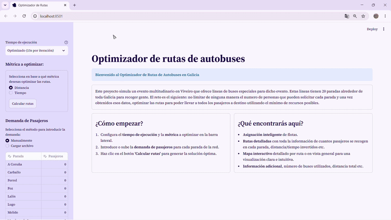

# Optimizador de Rutas de Transporte (VRP) - Galicia

Aplicación web interactiva que resuelve una variante del Problema de Enrutamiento de Vehículos (VRP) aplicado a la logística de transporte de pasajeros para un evento multitudinario en Galicia.

El proyecto utiliza Investigación Operativa (Programación Lineal Entera Mixta - MILP) para asignar flotas de autobuses de diferentes capacidades y trazar las rutas óptimas, minimizando la distancia o el tiempo total de viaje.

[**Prueba la aplicación aquí**]([ENLACE_A_STREAMLIT_CLOUD_AQUI])



## Índice

1. [Motivación del Proyecto](#motivacion-del-proyecto)
2. [Arquitectura del Proyecto](#arquitectura-del-proyecto)
3. [Funcionamiento y Escalabilidad](#funcionamiento-y-escalabilidad)
4. [Cómo usar el proyecto](#como-usar-el-proyecto)
5. [Estructura del Repositorio](#estructura-del-repositorio)
6. [Sobre el autor](#sobre-el-autor)

---

## Motivación del Proyecto

Este proyecto nace durante el verano como una iniciativa personal para adquirir nuevas competencias orientadas a mi futuro laboral. Mi objetivo principal fue combinar el desarrollo en Python con los conocimientos matemáticos adquiridos durante mi grado universitario, centrándome específicamente en el área de la **Investigación Operativa**.

El reto logístico planteado consiste en gestionar el transporte de miles de asistentes a un gran evento en Viveiro desde 20 de las principales ciudades gallegas. El objetivo no es solo encontrar "una ruta", sino diseñar matemáticamente la **red de transporte más eficiente**, logrando:

* **Minimizar los costes operativos** (tiempo o distancia total).
* **Asignar inteligentemente vehículos** de distinta capacidad en función de la demanda real.
* **Resolver la explosión combinatoria** inherente a los problemas NP-hard aplicando heurísticas de reducción de variables.
* **Mostrar gráficamente los resultados** con tablas y un mapa interactivo donde visualizar claramente la solución encontrada.

---

## Arquitectura del Proyecto

El desarrollo se divide en tres bloques técnicos fundamentales:

### 1. Obtención y procesamiento de datos
Para que el modelo de optimización no se base en distancias teóricas, se ha construido una red basada en la infraestructura vial real mediante la API de **OSRM (Open Source Routing Machine)**. 

El repositorio incluye los scripts responsables de la recolección de esta información:
* **`obtencion_matrices.py`**: A partir de las coordenadas de las 21 ciudades, consulta el endpoint *Table API* (`table/v1/driving`) de OSRM. Extrae las matrices asimétricas de duraciones y distancias por carretera, procesándolas con Pandas para generar los archivos `matriz_distancias.csv` y `matriz_tiempos.csv`.
* **`generar_geometrias.py`**: Consulta el endpoint *Route API* (`route/v1/driving`) para descargar las polilíneas GeoJSON exactas del trayecto por carretera entre cada par de ciudades. Se almacena en `geometrias_rutas.json`, permitiendo a *Folium* renderizar en la web el trazado físico real de las rutas calculadas.
Estas funciones se ejecutan una sola vez para extraer y generar los archivos de datos, los cuales se cargan de forma local en el programa principal para garantizar una respuesta inmediata en cada ejecución.

### 2. Motor de Optimización
Es el núcleo de la aplicación y donde reside la mayor complejidad algorítmica, alojado en `optimizador.py`. El problema está formulado utilizando la librería **PuLP** y el resolutor de código abierto **CBC**, incorporando técnicas para asegurar el rendimiento:
* **Corrección de la Desigualdad Triangular (Grafos):** Se implementó el algoritmo de Dijkstra con **NetworkX** para recalcular los caminos mínimos. Esto asegura que el coste directo entre dos nodos $A 
ightarrow C$ siempre sea menor o igual que el desvío $A 
ightarrow B 
ightarrow C$, evitando comportamientos anómalos del solver.
* **Heurística de Asignación Directa:** Los autobuses que logran llenarse en una única parada de origen se extraen del modelo algebraico principal, asignándoles rutas directas de inmediato. Esto reduce drásticamente el espacio de búsqueda.
* **Poda Estricta de Variables de Decisión ($x_{i,j}$):** Se incluyó una condición lógica pre-optimización que impide la creación de variables binarias para trayectos que alejen el autobús de su destino final así como tampoco se consideran trayectos entre paradas absurdamente lejanas. Esta técnica reduce considerablemente la cantidad de variables y con ello el tiempo de ejecución.
* **Variables de Holgura Dinámicas:** Implementación de bucles para inyectar recursos (autobuses disponibles) de forma controlada ($+\epsilon$), asegurando que el problema siempre sea factible sin saturar la memoria.

### 3. Interfaz Gráfica
Desarrollada con **Streamlit**, proporciona un entorno accesible donde los usuarios pueden interactuar con el modelo matemático sin necesidad de conocimientos de programación, visualizando los resultados a través de tablas de datos y mapas interactivos renderizados con **Folium**.

---

## Funcionamiento y Escalabilidad

En la versión actual del proyecto, las 21 paradas están predefinidas. En cada ejecución, el usuario puede ajustar el número de pasajeros que solicitan subir en cada ubicación, simulando la venta real de billetes. Al no establecer un límite artificial de plazas totales, este modelo lograría que ningún asistente que quisiera una
plaza se quedara sin ella por sold out.

Una vez ejecutado, la aplicación devuelve el desglose de rutas detalladas y un mapa interactivo para su visualización.

**Escalabilidad:** 
El sistema está diseñado de forma modular. Las paradas se leen desde un archivo de coordenadas JSON, lo que significa que sustituyendo este archivo por uno nuevo y ajustando pequeñas moldificaciones en el código, el programa puede adaptarse rápidamente para operar sobre una red de ciudades completamente diferente o hacia un destino distinto. Asimismo, el motor de optimización es lo suficientemente flexible como para adaptarse a otras variantes logísticas (rutas marítimas, flotas de reparto de mercancías, etc.).

---

## Cómo usar el proyecto

### Opción 1: Uso rápido en la Nube

El proyecto está desplegado en *Streamlit Community Cloud*, por lo que no requiere ninguna instalación en tu equipo:

1. Entra en la [**Aplicación Web**]([ENLACE_A_TU_STREAMLIT_CLOUD_AQUI]).
2. Selecciona la métrica a optimizar (Distancia o Tiempo) y el tiempo límite de ejecución del solver.
3. Introduce la demanda de pasajeros manualmente en la tabla o sube un archivo con los datos. Pulsando en "Instrucciones de formato" puedes ver los tipos de archivo permitidos y descargar un archivo de ejemplo.
4. Haz clic en **"Calcular rutas"** y explora los resultados.

### Opción 2: Ejecución Local

Ideal para auditar el código, modificar coeficientes fijos del modelo, realizar pruebas de estrés al solver o utilizar el motor algebraico para un proyecto derivado. 

**Prerrequisitos:** Python 3.11 o superior instalado en el sistema.

1. **Clona el repositorio**:
   ```bash
   git clone https://github.com/pedro-portela-fernandez/optimizador-rutas-autobuses.git
   cd optimizador-rutas-autobuses
   ```

2. **Crea y activa un entorno virtual**:
   ```bash
   python -m venv venv
   source venv/bin/activate  # En Windows: venv\Scriptsctivate
   ```

3. **Instala las dependencias necesarias:**
   ```bash
   pip install -r requirements.txt
   ```

4. **Ejecuta la interfaz de la aplicación:**
   ```bash
   streamlit run app.py
   ```

---

## Estructura del Repositorio

* `app.py`: Punto de entrada principal. Gestiona la interfaz de usuario (Streamlit), subida de archivos, estado de sesión y desglose tabular de resultados.
* `optimizador.py`: Motor lógico. Contiene la formulación del modelo MILP (PuLP), integraciones topológicas (NetworkX) y parámetros del solver.
* `mapa.py`: Módulo dedicado al renderizado gráfico del VRP mediante Folium y cartografía base.
* `generar_geometrias.py` y `obtencion_matrices.py`: Scripts extractores encargados de las peticiones a las APIs de OSRM.
* `data/`: Directorio que almacena `nodos_galicia.json`, las geometrías viales y las matrices base precalculadas en formato `.csv`.
* `requirements.txt`: Listado de dependencias exactas para la ejecución del proyecto.

---

## Sobre el autor

Soy estudiante de Matemáticas con vocación por la **Investigación Operativa, la optimización combinatoria y el análisis de datos**. Busco aplicar modelos matemáticos rigurosos y herramientas computacionales para resolver problemas logísticos y de negocio del mundo real.

* **LinkedIn:** [Tu Nombre en LinkedIn]([TU_ENLACE_A_LINKEDIN_AQUI])
* **Email:** [Tu Email](mailto:tu.email@ejemplo.com)
* **GitHub:** [@tu-usuario](https://github.com/[TU-USUARIO-AQUI])

*Si tienes alguna sugerencia de mejora o bien te surge cualquier problema o cuestión con el proyecto, no dudes en abrir una Issue en este repositorio o contactar directamente conmigo. El feedback siempre es bienvenido.*

